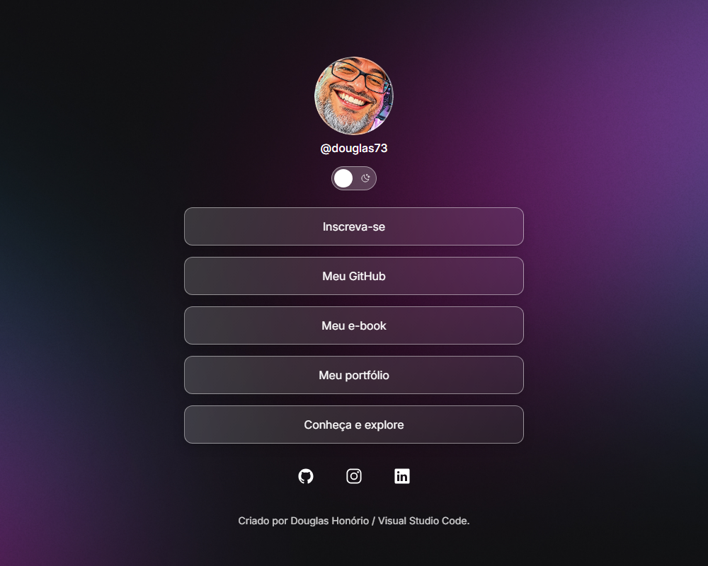
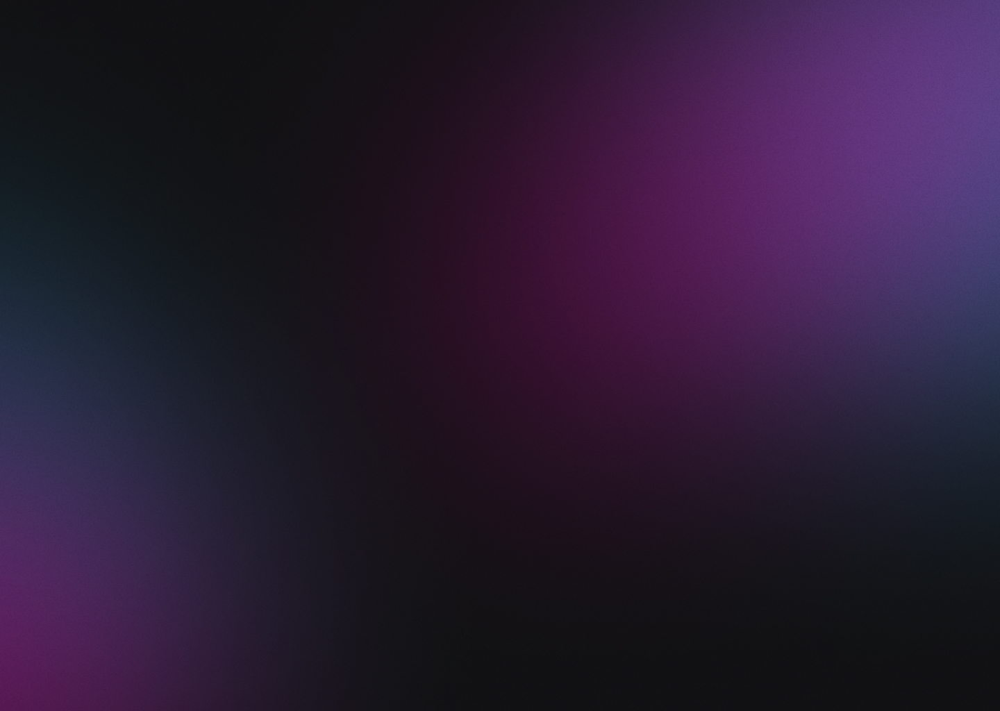

# DevLinks

Página pessoal de links para reunir redes sociais e conteúdos em um só lugar. O projeto tem layout responsivo, tema claro e escuro e uma interface com efeitos sutis de transparência e interação.

**Repositório:** [github.com/dhonorio73/projetos-rckt](https://github.com/dhonorio73/projetos-rckt)

**Acesse o projeto:** [DevLinks no GitHub Pages](https://dhonorio73.github.io/projetos-rckt/)

## Prévia

<p align="center">
  
</p>

<p align="center">
  
</p>

<p align="center">
  
  
</p>

<p align="center">
  <em>Tema escuro</em>&nbsp;&nbsp;&nbsp;&nbsp;&nbsp;&nbsp;&nbsp;&nbsp;&nbsp;&nbsp;
  <em>Tema claro</em>
</p>

## Visão geral

A página apresenta o perfil de Douglas Honório, links de destaque e acesso às redes sociais. O switch abaixo do nome alterna entre os temas claro e escuro.

### Recursos

- Layout adaptável para dispositivos móveis e desktop.
- Alternância entre tema claro e escuro.
- Links para GitHub, Instagram e LinkedIn, abertos em uma nova aba.
- Ícones Ionicons e fonte Inter.
- Estados de foco visíveis para navegação por teclado.
- Efeitos de hover nos links.

## Tecnologias

- **HTML5** — estrutura e conteúdo da página.
- **CSS3** — layout responsivo, temas claro e escuro e efeitos visuais.
- **JavaScript** — alternância entre os temas.
- [**Ionicons**](https://ionic.io/ionicons) — ícones das redes sociais.
- [**Google Fonts — Inter**](https://fonts.google.com/specimen/Inter) — tipografia do projeto.

## Aprendizado

Pratiquei a manipulação do DOM com JavaScript para alternar os temas e atualizar o estado acessível do switch.

## Executar localmente

Não é necessário instalar dependências.

1. Clone o repositório:

   ```bash
   git clone https://github.com/dhonorio73/projetos-rckt.git
   ```

2. Abra a pasta no Visual Studio Code.
3. Abra `index.html` no navegador ou use a extensão Live Server para executar o projeto em um servidor local.

Os ícones e a fonte são carregados de serviços externos, então é necessária uma conexão com a internet para exibi-los.

## Estrutura

```text
.
├── assets/
│   ├── project-preview.png
│   ├── avatar-light.png
│   ├── avatar.png
│   ├── bg-desktop-light.jpg
│   ├── bg-desktop.jpg
│   ├── bg-mobile-light.jpg
│   ├── bg-mobile.jpg
│   ├── moon-stars.svg
│   └── sun.svg
├── index.html
├── style.css
└── theme.js
```

## Personalização

- Atualize a foto, o nome e os destinos dos links em `index.html`.
- Ajuste cores, fundos e espaçamentos em `style.css`.
- O comportamento do switch de tema fica em `theme.js`.
- Os fundos, avatares e ícones locais estão na pasta `assets/`.

## Redes sociais

- [GitHub](https://github.com/Dhonorio73)
- [Instagram](https://www.instagram.com/dhonorio73)
- [LinkedIn](https://www.linkedin.com/in/dhonorio73)

---

Criado por **Douglas Honório**.
